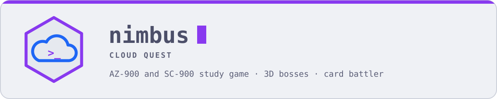
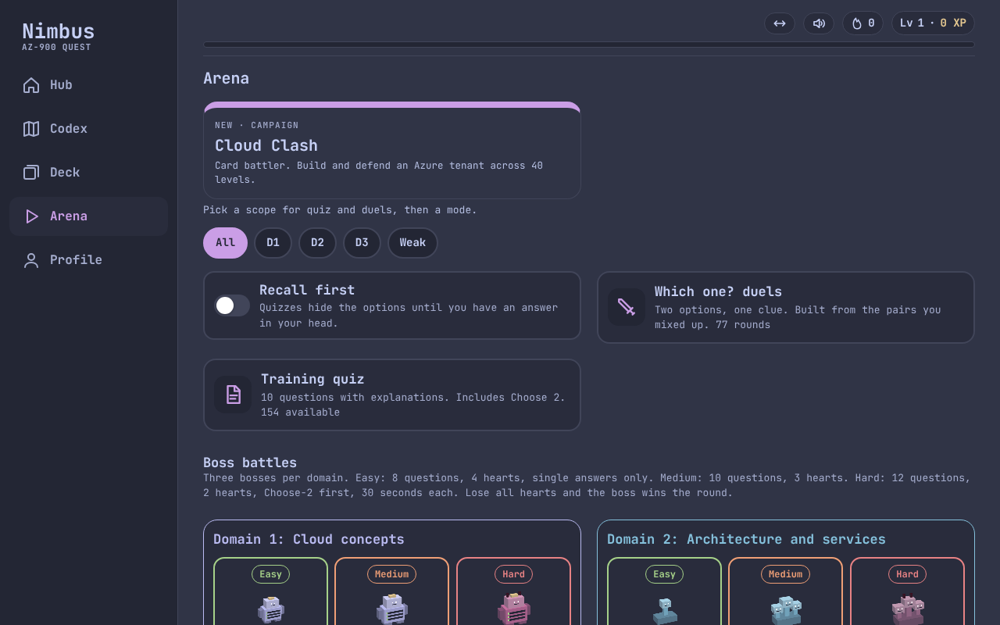
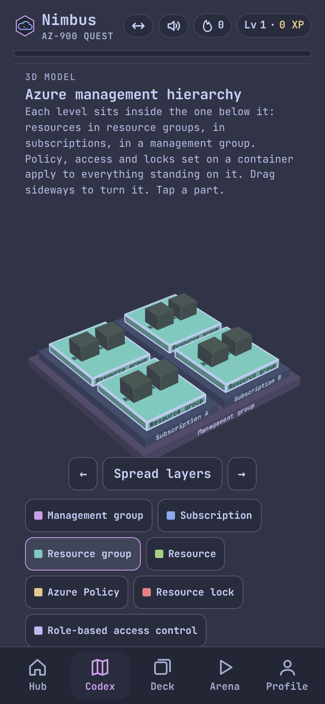

<picture>
  <source media="(prefers-color-scheme: dark)" srcset="assets/banner-dark.svg">
  
</picture>

<p align="center">
  <a href="https://cop1ouss.github.io/nimbus-cloud-quest/"></a>
</p>
<p align="center">
  <a href="https://github.com/Cop1ouss/nimbus-cloud-quest/actions/workflows/ci.yml"></a>
  <a href="https://github.com/Cop1ouss/nimbus-cloud-quest/actions/workflows/codeql.yml"></a>
  <a href="SECURITY.md"></a>
  
  
  
</p>

<p align="center">
  <a href="https://cop1ouss.github.io/nimbus-cloud-quest/"></a>
  <a href="https://cop1ouss.github.io/nimbus-cloud-quest/"></a>
</p>

A phone-first study game for my Azure security path: **AZ-900 → SC-900 → AZ-104 → SC-500**. AZ-900 (Azure Fundamentals) and SC-900 (Security, Compliance, and Identity Fundamentals) have content now. Later exams are added as I pass each one. The whole app is one `index.html` with no build step, no backend and no dependencies.

**How it works**

- **Codex:** every exam objective as a stop on a map, with notes, traps to avoid, and **interactive 3D models** you can turn and tap: defense in depth, Zero Trust, shared responsibility, the Azure management hierarchy, regions and zones, virtual networks, Conditional Access and Defender XDR.
- **Deck:** spaced-repetition flashcards that flip back, rated Again, Shaky, Good or Easy.
- **Arena:** training quizzes (including Choose 2, Yes/No and match questions), "Which one?" duels for look-alike services, and **3D boss battles** at easy, medium and hard.
- **Mock exams:** timed and weighted by domain like the real exam.
- **Cloud Clash:** a 40-level card battler where you defend an Azure tenant. Every card asks an exam question before it plays.
- **Progress:** XP, levels, streaks, badges and per-objective accuracy.

## Use it on your phone

1. Open **[cop1ouss.github.io/nimbus-cloud-quest](https://cop1ouss.github.io/nimbus-cloud-quest/)** in Safari.
2. Tap **Share**, then **Add to Home Screen**.
3. It opens full screen with its own icon, like an app.

## Data & privacy

Progress is stored in your browser's `localStorage` on each device. Nothing is sent to a server, and nothing is stored in this repo. To move progress between devices, use **Profile → Tools → Back up progress**, then **Restore backup** on the other device.

## Working on it

`index.html` is built from the files in `src/`. Edit those, never `index.html` directly.

| Path | What it is |
| --- | --- |
| `src/head.html` | Styles (Catppuccin Frappé and Latte tokens), the page shell and the header logo |
| `src/app.js` | The whole app: Codex, Deck, Arena, bosses, mocks, Cloud Clash and the 3D models |
| `src/data_packs.json` | All content: AZ-900 and SC-900 cards, questions, duels, Codex stops and the Cloud Clash campaign |
| `content/` | Scripts that generate content into `src/data_packs.json`: the Cloud Clash worlds and the SC-900 pack |
| `tests/` | Playwright checks: regressions, a 40-level campaign bot, backup and restore, accessibility, SC-900 and 3D models |
| `docs/` | PRD, Build Protocol and the game design doc |

```bash
python3 build.py                    # rebuild index.html from src/
python3 build.py --check            # CI: fail if index.html is stale
python3 build.py --icons            # redraw the app icons from the header logo (needs Playwright)
python3 content/camp_data.py        # regenerate Cloud Clash World 1 into src/data_packs.json
python3 content/camp_data2.py       # regenerate Worlds 2 to 4
(cd content/sc && python3 sc_build.py)   # regenerate the SC-900 pack
pip install playwright && python3 -m playwright install chromium
python3 tests/t42.py                # SC-900 pack and 3D models smoke test
npm i axe-core@4.10.2 && python3 tests/t41.py   # accessibility, Frappé and Latte
```

## Related

- [`secplus-tracker`](https://github.com/Cop1ouss/secplus-tracker): CompTIA Security+ study tracker, same gamified approach.
- [`ccna-tracker`](https://github.com/Cop1ouss/ccna-tracker): CCNA 200-301 labs, drills and boss battles.

## Project docs

| | |
| --- | --- |
| 📋 [PRD](docs/PRD.md) | The problem, the goal, scope and the finish line |
| 🧭 [Build Protocol](docs/BUILD-PROTOCOL.md) | The five gem phases and where the build stands |
| 🛡️ [Security policy](SECURITY.md) | How to report a vulnerability privately |
| ⚖️ [License](LICENSE) | MIT |
| 🧪 [CI](.github/workflows/ci.yml) | What runs on every pull request |

---

<p align="center"><sub>Built by <a href="https://github.com/Cop1ouss">Dajoni Gomez</a> · part of the <a href="https://cop1ouss.github.io/Cop1ouss/">Uncook</a> journey log · © 2026 Dajoni Gomez. Uncook™</sub></p>
